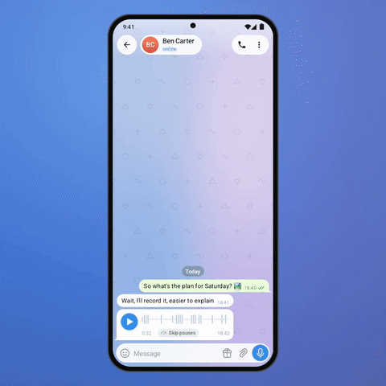

# ⏩ Skip Silence in Voice Messages

Long voice messages are full of "hmm…" pauses. One tap on **Skip pauses** and playback jumps over
every pause longer than 0.7 s. The waveform shows what will be skipped, and the chip says how much
time you save.

<p align="center"></p>

<p align="center"><b>&#9654;&#65039; <a href="demo.mp4">Full-quality video (demo.mp4)</a></b> &middot; Telegram for Android 12.4 design &middot; Android 8+</p>

<p align="center">screen recordings on Android have no sound; the jumps are visible on the waveform and the timer</p>

## How it works

- `SilenceSkipper` scans the PCM once: RMS per 20 ms, silence = 30 dB below the loudest part,
  pauses shorter than 0.7 s stay (they are part of speech), 180 ms are kept at both edges.
- `skipTarget(position)` tells the player where to continue; `savedMs()` feeds the chip.

## Integration into Telegram for Android

| Where | What |
|---|---|
| `MediaController` voice playback | after decoding (Opus is already decoded for playback) run `SilenceSkipper`, cache per document |
| `MediaController.updateProgress` | when `skipTarget(pos) >= 0` and the setting is on, `seekToProgress` |
| `ChatMessageCell` voice layout / `FragmentContextView` player | the **Skip pauses** chip next to the speed button; faded bars for pauses |

Files: [`SilenceSkipper.java`](voice-skip-silence/src/main/java/org/telegram/ui/Components/SilenceSkipper.java).

## Build and run

Requirements: JDK 17 and the Android SDK (platform 36). Point Gradle at the SDK with
`local.properties` (`sdk.dir=/path/to/Android/sdk`) or `ANDROID_HOME`.

```
./gradlew :voice-skip-silence:assembleDebug
adb install voice-skip-silence/build/outputs/apk/debug/voice-skip-silence-debug.apk
```

The app opens on the demo screen and works by hand. For the presentation look of the video:

```
adb shell am start -n org.telegram.lab.voiceskip/.MainActivity --ez stage true --ez autoplay true
```

## Project layout

| Path | What it is |
|---|---|
| `voice-skip-silence/src/main/java/org/telegram/ui/Components/` | **the feature itself**, drop-in for Telegram's `TMessagesProj` (Android SDK + `AndroidUtilities` only) |
| `voice-skip-silence/src/main/java/org/telegram/lab/voiceskip/` | the demo screen and the scripted demo used for the video |
| `core/` | Telegram 12.4-style UI the demo is built on: chat screen, bubbles, composer, sheets, menus, Telegram's own icons |

## License

GPL-2.0, same as Telegram for Android, whose icons are included in `core`.